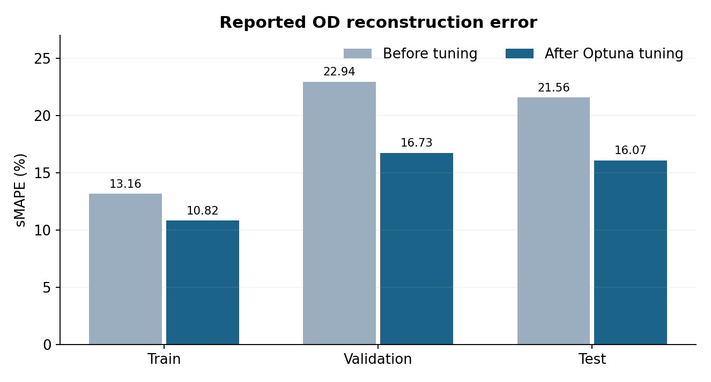
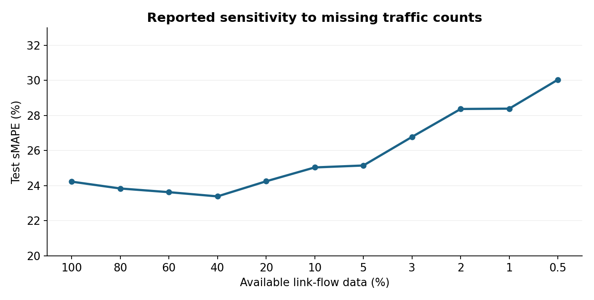
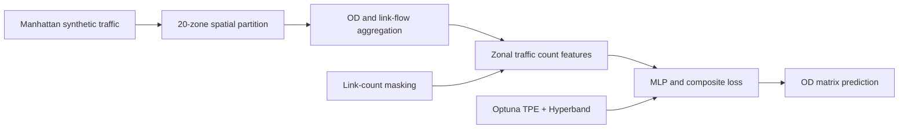
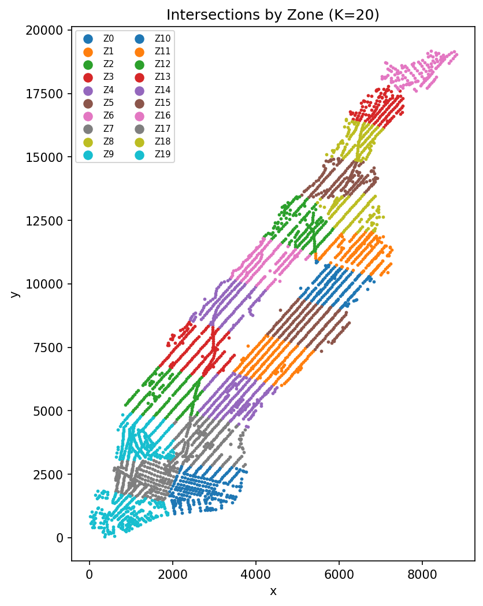

# Manhattan Origin–Destination Matrix Estimation with Deep Learning

**Reconstructing a 20 × 20 urban origin–destination (OD) matrix from sparse, aggregated traffic counts using a multilayer perceptron (MLP).**

*Transportation AI · Traffic demand estimation · PyTorch · Optuna · Synthetic Manhattan network*

**Authors:** [Mohammad Emad Rashidi and Ahmad Mansour](CONTRIBUTORS.md)  
**Affiliation:** George Washington University · April 2026

## Overview

Origin–destination matrices quantify trips between geographic zones and inform transportation planning and traffic-network modeling. Directly observing complete OD flows is difficult, while traffic sensors provide only partial information about vehicle movement.

This study addresses the inverse problem by aggregating network-link traffic counts into **20 K-means-based zones** and learning a mapping from compact zonal observations to a complete **20 × 20 OD matrix**. The workflow spans network zoning, synthetic traffic data processing, zonal aggregation, supervised MLP training, hyperparameter optimization, and resilience analysis under missing sensor information.

## Research highlights

- **Compact zonal representation:** within-zone and adjacent-zone traffic counts, augmented with origin/destination totals and diagonal features.
- **Neural reconstruction:** a PyTorch MLP trained to recover OD structure and demand magnitude.
- **Conservation-aware training:** combined regression and structural losses for marginals, intra-zone flows, and total demand.
- **Automated tuning:** Optuna TPE sampling and Hyperband pruning over architectural, optimization, and loss settings.
- **Robustness evaluation:** experiments with progressively reduced availability of underlying link-flow observations.

## Experimental performance



| Evaluation metric | Before tuning | After tuning |
|---|---:|---:|
| Training sMAPE | 13.16% | 10.82% |
| Validation sMAPE | 22.94% | 16.73% |
| **Test sMAPE** | **21.56%** | **16.07%** |
| Test total-flow error | 3.95% | 1.70% |
| Test MAE | 2.89 | 3.04 |

These values summarize the original project experiments. The training datasets and model checkpoints are **not** included in this repository, so the figures have **not been independently reproduced from the packaged code**. [Results and interpretation](docs/results.md)

## Missing-data sensitivity



The separate data-availability experiment found test sMAPE near 23–24% with moderate traffic-count losses, increasing to **30.04%** with only **0.5%** of link data remaining. This sensitivity experiment has a **different evaluation baseline** from the tuned-model comparison above; the two sets of test scores should not be treated as interchangeable. [Detailed results](docs/results.md)

## Methodology



Manhattan network zoning used in the modeling workflow:



The detailed methods describe the feature representation, train/validation/test partition, architecture, tuning objective, and experimental limitations: [Methodology](docs/methodology.md).

## Repository structure

```text
manhattan-od-matrix-estimation-mlp/
├── pipeline/                       # Data preparation, modeling, tuning scripts
│   ├── create_zones.py
│   ├── generate_link_od.py
│   ├── extract_link_counts.py
│   ├── convert_zonal_od.py
│   ├── aggregate_zonal_counts.py
│   ├── aggregate_zonal_counts_masked.py
│   ├── train_od_mlp.py
│   ├── train_od_mlp_variant.py
│   └── tune_hyperparameters.py
├── assets/figures/                 # Zoning, tuning and robustness figures
├── docs/                           # Methodology, data, results and reproduction notes
├── results/                        # Local outputs (gitignored)
├── requirements.txt
├── CONTRIBUTORS.md
├── README.md
└── .gitignore
```

## Running the workflow

The pipeline uses Python 3.10–3.12 and the packages in `requirements.txt`.

```bash
python -m venv .venv
# Activate your environment, then:
pip install -r requirements.txt
cd pipeline
python train_od_mlp.py --K 20
```

**Data prerequisite:** the original synthetic CityFlow Manhattan scenario JSON, network geometry, and processed counts/OD files are not bundled in the supplied archive. The training command above therefore **requires the input files described in [Data requirements](docs/data.md)**. [Reproduction guide](docs/reproducibility.md) lists the preprocessing sequence and expected directory structure.

An Optuna search may be started after assembling the data:

```bash
python tune_hyperparameters.py --n_trials 40 --pruner hyperband --report_every 10
```

## Project documentation

- [Methodology](docs/methodology.md)
- [Experimental results](docs/results.md)
- [Data requirements](docs/data.md)
- [Reproduction and data constraints](docs/reproducibility.md)

## Scope and limitations

Results are based on **synthetic traffic from four one-hour scenarios** on a fixed 20-zone Manhattan network. The input networks and original training artifacts were not present in the provided source archive, and the original experimental values have not been independently reproduced from this archive. Transfer to measured detector data or other networks remains outside the evaluated scope.

The source code is joint academic work by the credited contributors. No open-source license is assigned here; third-party traffic data and software dependencies remain subject to their respective terms.
