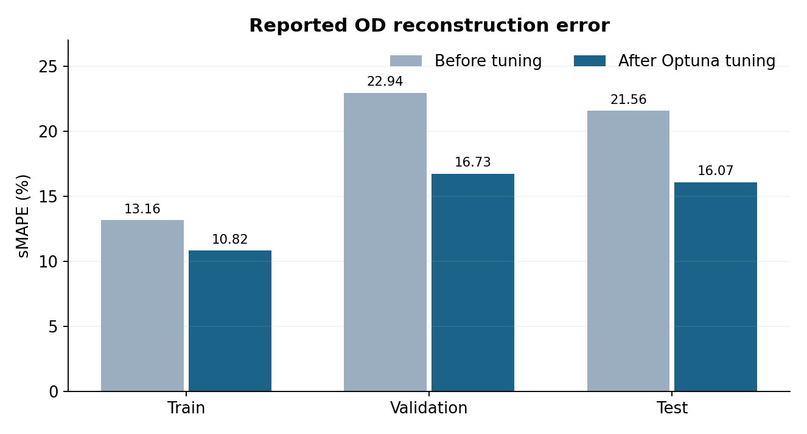
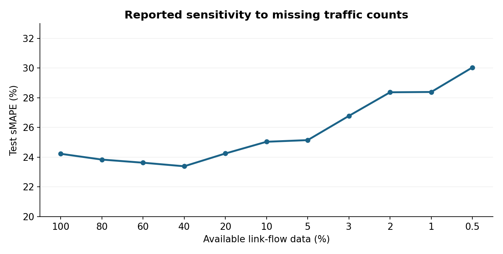

# Experimental results

The tables below record results obtained during the original project experiments. They are included to document the model evaluation; these numbers have **not been independently reproduced using the packaged repository**, because the underlying datasets and saved checkpoints are not included.

## Hyperparameter-optimization comparison

| Metric | Before: train | Before: validation | Before: test | After: train | After: validation | After: test |
|---|---:|---:|---:|---:|---:|---:|
| sMAPE (%) | 13.16 | 22.94 | 21.56 | 10.82 | 16.73 | 16.07 |
| MAE | 3.55 | 3.07 | 2.89 | 3.35 | 3.15 | 3.04 |
| RMSE | 4.52 | 3.92 | 3.76 | 4.45 | 4.01 | 3.94 |
| Marginal MAE | 27.98 | 15.11 | 14.46 | 32.01 | 17.88 | 16.63 |
| Total flow error (%) | 4.79 | 4.80 | 3.95 | 3.33 | 4.69 | 1.70 |

Tuning improved **test sMAPE by 5.49 percentage points** (21.56% → 16.07%) and test total-flow error (3.95% → 1.70%), while **test MAE, RMSE and marginal MAE increased** slightly. The trade-off is important: improvement is not uniform across all objectives.

## Robustness to masked link data

| Available data (%) | Test sMAPE (%) | Marginal MAE | Total flow error (%) |
|---:|---:|---:|---:|
| 100 | 24.23 | 15.72 | 2.85 |
| 80 | 23.84 | 17.04 | 4.01 |
| 60 | 23.63 | 22.20 | 9.22 |
| 40 | 23.39 | 18.28 | 6.82 |
| 20 | 24.25 | 18.53 | 7.95 |
| 10 | 25.04 | 25.19 | 13.42 |
| 5 | 25.15 | 22.25 | 10.93 |
| 3 | 26.78 | 24.27 | 10.61 |
| 2 | 28.37 | 37.94 | 16.72 |
| 1 | 28.39 | 36.00 | 20.90 |
| 0.5 | 30.04 | 50.45 | 29.53 |

The masking experiments were evaluated separately from the headline tuning comparison; their **100% observation result (24.23%) is not the same baseline as the tuned-model test sMAPE (16.07%)**. Values should be compared within, not across, the two experimental setups.

## Scope of the evidence

Four one-hour simulated Manhattan traffic-demand scenarios were studied, at flow levels approximately 7,846, 11,756, 21,430 and 31,217 vehicles per hour. The fixed city network, synthetic demand generation and small scenario variety limit claims of generalization to real detector observations or other urban networks.
